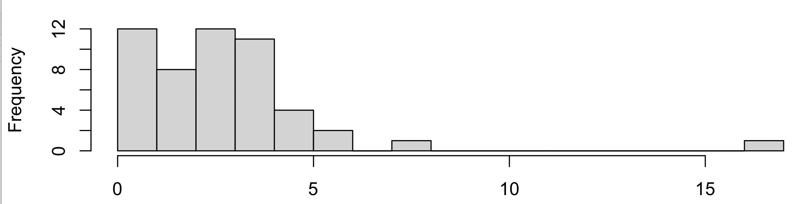
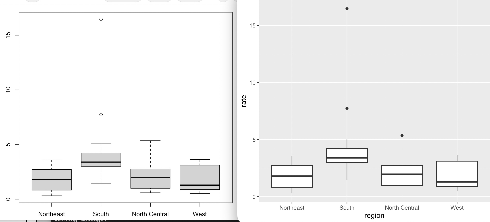
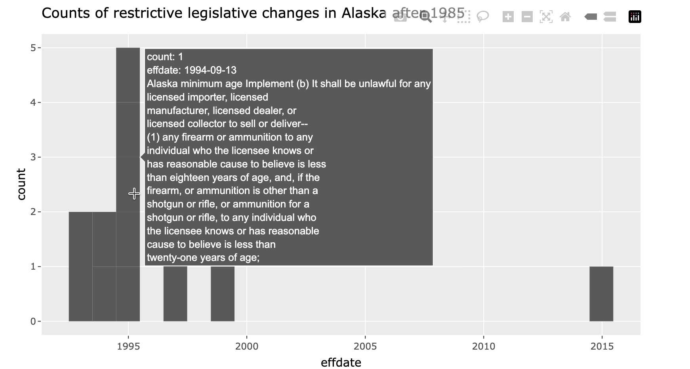

Total points (of 83): \_\_\_


<hr>
Q1.  You are given a text file 'states.csv' with the following appearance.

```
state,abb,region,population,total
Alabama,AL,South,4779736,135
Alaska,AK,West,710231,19
Arizona,AZ,West,6392017,232
Arkansas,AR,South,2915918,93
California,CA,West,37253956,1257
Colorado,CO,West,5029196,65
Connecticut,CT,Northeast,3574097,97
Delaware,DE,South,897934,38
District of Columbia,DC,South,601723,99
Florida,FL,South,19687653,669
```


You issue the R command `z <- read.csv("states.csv")` and the
command succeeds.  What is the
result of `class(z)`? (1pt)

<hr>
SOLUTION: "data.frame"

PURPOSE: Examine understanding of base R data ingestion process, concept
of class, precision of stating "result" of a specific operation.

SCORING: data.frame with period got full marks (quoted or not), dataframe or data frame
got half, all else zero.
<hr>

\pagebreak

Instead of a successful read, you find R responding with
```
Error in file(file, "rt") : cannot open the connection
In addition: Warning message:
In file(file, "rt") : cannot open file 'states.csv': No such file or directory
```
However, you check with your operating system and find
```
username$ ls -tl states.csv
-rw-r--r--  1 username  staff  206 Oct 10 06:57 states.csv
```
Give an explanation for the error event in the R session. (2pts)

<hr>
SOLUTION: The path given is not correct for the given command/session.

PURPOSE: Understanding of error events, paths, current working folder.

SCORING: Should mention path or current working folder for full credit.
<hr>

\vspace{2cm}

Indicate two ways in which you might respond to achieve a successful
read. (2pts)

<hr>
POSSIBLE SOLUTIONS: 1) change the path given to `read.csv` to be correct for
the working folder of your R session.  2) change the working folder of your
R session.

PURPOSE: Understanding role of path and error message.

SCORING: Liberal.  Full marks require attention to current working directory and full path.
<hr>


Assume the `read.csv` command  succeeds.
What is the result of `lapply(z, class)`?  Be as precise as possible.
You should describe the data type of the result, and as much of the
content of the result as you can. (3pts)

```{r abc, results="hide",echo=FALSE}
z = read.csv("~/states.csv")
```
<hr>
SOLUTION: "list" should be part of the answer.  

PURPOSE: Understanding *apply concept and class; attendence to request for 'content' of
result.

SCORING: Partial credit was given for various responses.
```{r def,echo=FALSE}
lapply(z,class)
```
<hr>


What is the result of `sapply(z, class)`?  Again, be precise. (2pts)

<hr>
SOLUTION: "vector" should be part of the answer.
```{r ghi,echo=FALSE}
sapply(z,class)
```

PURPOSE: Distinguish behaviors of lapply and sapply.

SCORING: Liberal, as above.
<hr>


Give the command that changes the class of `z$region` to `factor`.  Why
would you do this?  (3pts)

<hr>
SOLUTION:
```
z$region = factor(z$region)
```
or 
```
z |> dplyr::mutate(region = factor(region))
```

PURPOSE: Recognize that 'change' implies assignment or mutation.  Articulate role of 'factor',
not significantly handled in the course to date.

SCORING: 1 point for assignment or mutation, 1 point for invoking `factor()`, 1 point for explanation
<hr>


Q2.   In problem set 3 we used
```
> cdcmurd <- read.csv("https://tinyurl.com/cdcmurder")
```

Many users succeeded with this command.  When one user tried it, the result was:
```
Error in file(file, "rt") : 
  cannot open the connection to 'https://tinyurl.com/cdcmurder'
In addition: Warning message:
In file(file, "rt") :
  URL 'https://tinyurl.com/cdcmurder': status was 'Couldn't resolve host name'
```
What is a likely explanation for the error? (1pt)

<hr>
SOLUTION: no network access

PURPOSE: Recognition of frailty of network operations to retrieve data

SCORING: For full marks, mention network issue
<hr>

Once the `read.csv` succeeds, what is the result of `save(cdcmurd, file="cdcmurd.rda")`?  Be
as precise as possible. (2pts)

<hr>
SOLUTION: creates file `cdcmurd.rda` in current folder and populates it.
RDA format is specific to R.

PURPOSE: Understand serialization process.

SCORING: Must mention "create" and some aspect of data format for full marks.
<hr>

After the successful `read.csv` command above, one user found:
```
> cdcmurd |> names()
[1] "YEAR"       "Location"   "Death.Rate" "Deaths"     "URL"       
> cdcmurd |> filter(location == "NY")
Error: object 'location' not found
```
Why would this happen? (1pt)

<hr>
SOLUTION: lower case 'l' "location" is not in scope

PURPOSE: Attendance to case significance; recognition of semantics of "filter"

SCORING: Liberal
<hr>

\vspace{2cm}
Then they found
```
> cdcmurd |> filter(Location == "NY")
Error: object 'Location' not found

```
Why? (2pts)

<hr>
SOLUTION: Without explicit use of `dplyr` this invokes `stats::filter` which
will not find `Location`.

PURPOSE: Attendance to case significance; recognition of semantics of "filter"

SCORING: one point for reference to dplyr (notice that it is used in the next problem,
you thus had a chance to go back), and one point for recognizing "filter" must be
used properly.  A number of students proposed that the task should address *column*
selection, which is a misconception.
<hr>


Q3.  You are in a fresh R session.  Assuming the
dplyr package is installed, what is the result of executing the following command?
Address as many effects on the R session as you can.  (3pts)

```
library(dplyr)
```

<hr>
SOLUTION: 1 pt for searchlist updated, 1 pt for functions available by name, 1 pt for doc available

PURPOSE: `library` is very important and has different side effects worthy of attention.

SCORING: Liberal
<hr>


Q4. We run the code
```
tt = replicate(1000, sample(1:52, size=1))
```
and find that
```
> mean(table(tt))
[1] 19.23
```
Why? (2pts)

<hr>
SOLUTION: It is sufficient to show $19.23 = 1000/52$ but more details are welcome.
`sample` as used draws a random value from 1:52, `replicate` does it repeatedly,
`table` collects the frequencies with which each value is drawn.  The average
frequency should be close to 1000*1/52 as each number had equal probability 1/52 of
being drawn.

PURPOSE: Explores capability of breaking down concise "workflows" to simulate and report on
random processes.

SCORING: It was sufficient to show the math.  Any text supplied had to make sense or score would be reduced.
<hr>


Q5. After running the following code chunk, what is the value of `x`? (2pts)
```
x <- 3
my_func <- function(y){
  x <- 5
  y+5
}
my_func(4)
```
<hr>
SOLUTION: 3

PURPOSE: Understand local vs. global scope of assignment actions.

SCORING: Strict
<hr>


Q6.  The sum of the first $n$ positive integers can be expressed as
$$
S_n = \sum_{i=1}^n i = \frac{n(n+1)}{2}
$$
What is the value of $S_{10}$? (1pt)


Write two R statements that evaluate $S_{10}$, one of which involves a vector. (2pts)

<hr>
SOLUTIONS: 55, `sum(1:10)`, `10*11/2`, etc.

PURPOSE: Gift.

SCORING: Strict.
<hr>

Write an R function called `sumn` that computes $S_n$ for any positive integer input $n$. (4pts)

<hr>
SOLUTION: Various possible; in class we will see an agentic solution of interest.

PURPOSE: Authoring functions, recognition of conditions specified in problem.

SCORING: 1 point for function definition, 1 point for detecting and stopping on non-positive input, 1 point
for detecting and stopping on non-integer input, 1 point for computing a correct answer with 
suitable input.
<hr>


\pagebreak

Q7. Consider the sequence of R commands:
```
txt = c("to be or not to be", "that is the question")
stxt = strsplit(txt, " ")
```
What is the class or type of `stxt`?  (1pt)

<hr>
SOLUTION: list

PURPOSE: Understand behavior of `strsplit` on vector input.

SCORING: Strict
<hr>

What is its length? (1pt)

<hr>
SOLUTION: 2

PURPOSE: as above

SCORING: Strict
<hr>

The result of `strsplit(txt[2], "")[[1]]` is a vector.  What is its length? (1pt)

<hr>
SOLUTION: 20

PURPOSE: Distinguish role of splitting by empty string (which was used repeatedly in class).

SCORING: Strict
<hr>

Write out the first five elements of this vector. (1pt)

<hr>
SOLUTION: "t", "h", "a", "t", " "

PURPOSE: Attend to indexing, strsplit behaviors, spaces as strings.

SCORING: Strict
<hr>

Consider `mys <- strsplit(txt[2], "")[[1]]`.  What is the value of `table(mys)["t"]`? (2pts)

<hr>
SOLUTION: a 'table' instance with named value 4

PURPOSE: Attend to behavior of `table`, indexing.

SCORING: Liberal
<hr>


Q8.  Anscombe's quartet is a collection of bivariate datasets.

```{r doans,echo=FALSE,message=FALSE,cache=TRUE}
     ff <- y ~ x
     mods <- setNames(as.list(1:4), paste0("lm", 1:4))
     for(i in 1:4) {
       ff[2:3] <- lapply(paste0(c("y","x"), i), as.name)
     }

     op <- par(mfrow = c(2, 2), mar = c(3,3,1,1))#, oma =  c(0, 0, 2, 0))
     for(i in 1:4) {
       ff[2:3] <- lapply(paste0(c("y","x"), i), as.name)
       plot(ff, data = anscombe, col = "red", pch = 21, bg = "orange", cex = 1.2,
            xlim = c(3, 19), ylim = c(3, 13), main=letters[i])
     }
     mtext("Anscombe's 4 Regression data sets", outer = TRUE, cex = 1.5)
     par(op)
```
For each display, a to d, provide a concise description (10 words or less) of
the data configuration in your own words. (4pts)

<hr>
SOLUTION: Text should include concepts: a) apparent linear association with error in response, b) apparently quadratic relation,
c) strict linear with "outlier", d) variability in y for one x value, with one aberrant (x,y) point.

PURPOSE: Demonstrate use of clear language to describe data displays.

SCORING: Liberal
<hr>

Q9.  Here are the anscombe datasets.
```
> anscombe
   x1 x2 x3 x4    y1   y2    y3    y4
1  10 10 10  8  8.04 9.14  7.46  6.58
2   8  8  8  8  6.95 8.14  6.77  5.76
3  13 13 13  8  7.58 8.74 12.74  7.71
4   9  9  9  8  8.81 8.77  7.11  8.84
5  11 11 11  8  8.33 9.26  7.81  8.47
6  14 14 14  8  9.96 8.10  8.84  7.04
7   6  6  6  8  7.24 6.13  6.08  5.25
8   4  4  4 19  4.26 3.10  5.39 12.50
9  12 12 12  8 10.84 9.13  8.15  5.56
10  7  7  7  8  4.82 7.26  6.42  7.91
11  5  5  5  8  5.68 4.74  5.73  6.89
```

Write out the result of `apply(anscombe,2,max)`. (3pts)

<hr>
SOLUTION:
```{r doapp,echo=FALSE}
apply(anscombe,2,max)
```

PURPOSE: Attend to meaning of `apply`.

SCORING: Strict
<hr>

Here are some manipulations of the anscombe dataset in plot "b" of Q8.

```
rbind(deltay= diff(anscombe[order(anscombe[,"x2"]),"y2"]),
  xmid= (sort(anscombe[,"x2"])[-11]+.5))
       [,1] [,2] [,3] [,4] [,5] [,6]  [,7]  [,8]  [,9] [,10]
deltay 1.64 1.39 1.13 0.88 0.63 0.37  0.12 -0.13 -0.39 -0.64
xmid   4.50 5.50 6.50 7.50 8.50 9.50 10.50 11.50 12.50 13.50
```

Explain what is going on in the creation of the row `deltay`. (3pts)

Use the relationships between the rows of the matrix above to
identify where on the x axis the values of `deltay` "change sign".  (1pt)

Sketch this x position on the graph for dataset "b" in Q8 with a   
vertical line.  (1pt)

<hr>
SOLUTIONS: "Explain" was handled well by many students.  Unravel the
code from inside.  The rows of the anscombe data are reordered and
column y2 is isolated with elements ordered to correspond with
increasing values of x2.  `diff` computes successive differences
(second - first), (third - second) and so on.  xmid is computed
as midpoints of ordered elements of x2, dropping the last to
conform to the vector of differences.  deltay changes sign
between elements 7 and 8, so around xmid value 11.

PURPOSE: Reading messy code, understanding diff, midpoint creation.

SCORING: Liberal.  Language had to make sense; graph needed to have
a line as requested.
<hr>

Recall that in Problem set 2, we defined a function to "trace
through" the points in the scatterplot for (x2, y2).  It had the form

$$
f(x) = c + 2.78x -.127x^2
$$

We can find the position of the extremal value of this $f(x)$ by taking
the first derivative with respect to $x$ and finding the value of $x$
at which the derivative is zero.  For this $f$, we get
$$
x_{max} = \frac{2.78}{2 \times 0.127} = 10.94
$$
How does this agree with your choice of where to position the
vertical line in the graph for dataset "b"? (2pts)


In what way does the `deltay` row of the matrix above relate to
the first derivative with respect to $x$ of $f(x)$ defined above? (2pts)

<hr>
SOLUTION: Agreement was reasonable

PURPOSE: Exercise a little bit of calculus.

SCORING: Liberal
<hr>

Q10.  Consider the dslabs murders dataset that we have spent much time with.

Describe precisely the consequences of the command (3pts)
```
murders$rate = 1e5*(murders$total / murders$population)
```

<hr>
SOLUTION: 1 pt for "updates the murders data frame with a new column", 1 pt for computing the
rate, 1 pt for taking the product to scale the rate to events per 100000

PURPOSE: Evaluate understanding and precision of description of rate 
calculation and assignment 

SCORING: Strict
<hr>

Given the rate computation just performed, tell what command produces (2pts)




Add an appropriate x-axis label.
According to this diagram there is a group of four states sharing approximately
the same murder rate.  What is your guess at this rate? (2pts)

<hr>
SOLUTION:  The text of the exam is unclear here because of the "2pts" after "produces".
Students were intended to explain the command that produces the diagram, which was
`hist()`.  The x-axis label could read "number of murders per 100000 population in US states".
The guess at the rate should have been around 4.5 per 100000.

PURPOSE: Recognition of the way in which such a diagram is produced, value of
accurate labeling of axes, reading histogram.

SCORING: Liberal.
<hr>


\pagebreak

Here are two displays of variation in murder rate stratified by region.



Given the computations on murders described thus far, 
provide the commands that would produce these displays.
Include any necessary library commands. (4pts)

LEFT:

\vspace{1cm}

RIGHT:

<hr>
SOLUTION: LEFT: `boxplot(split(murders$rate, murders$region))`.  
RIGHT: `ggplot(murders, aes(x=region, y=rate)) + geom_boxplot()`

PURPOSE: Distinguish base R graphics from ggplot2.  Demonstrate
methods of grouping.

SCORING: Not scored.  Printing was not clear enough.
<hr>

Q11.  What does `mean(murders$total > 500)` measure? (2pts)

<hr>
SOLUTION: Proportion of states with total murder count exceeding 500

PURPOSE: Role of taking average of an indicator (logical) variable.

SCORING: Strict
<hr>

Q12.  The goal is the three states with the most murders.
```
murders |> arrange(total) |> head(3) |> pull(state)
```
This runs without complaint and returns "Vermont", "North Dakota", "New Hampshire".
Fix the code. (2pts)

<hr>
SOLUTIONS: Q12-Q16 are very straightforward, test basic understanding of
syntax and semantics of R and ggplot2.

SCORING: Strict
<hr>


Q13.  Above we gave the code to compute a vector of rates, one per state.
Suppose we compute a "common rate" as
```
comm = sum(murders$total)/sum(murders$population)
```
How would you compute an expected number of murders for a
state with population ten million? (3pts)


Q14.  The goal is to extract from the murders dataset the row for Texas.  What
is the error in this command, and how is it to be repaired? (2pts)
```
murders[murders$state = "Texas", ]
```

Q15. The goal is to create a vector of names of western states that have fewer than 50 murders.
This command was attempted:
```
murders$state[murders$region == "West" | murders$total < 50]
```
This returns 23 names, but only 7 states meet the goal. Explain the extra 16, then repair the
code.  (2pts)


Q16.  A student wrote

```r
library(ggplot2)
ggplot(murders, aes(population, total)) |> geom_point()
```

R stops with `mapping must be created by aes()`. What is wrong, and what is the repair?  (2pts)


Q17.  In our work with RAND corporation gun legislation data, we created an interactive display.



Describe the software components underlying this type of display.  The base graphics
use ggplot2; what geom is used?  What package is necessary to get the text-on-hover behavior,
and what operation transforms the graphical object to an interactive browsable artifact?  (4pts)

<hr>
SOLUTION: 1 pt for indicating that the basis of the computations is a data.frame,
1 pt for indicating use of ggplot2 or geom_histogram, 1 pt for indicating that
aes must include some text parameter to manage hover behavior, 1 pt for
indicating role of plotly/ggplotly.

PURPOSE: To assess recollection of the work done with gunleg.qmd.

SCORING: Strict.
<hr>
